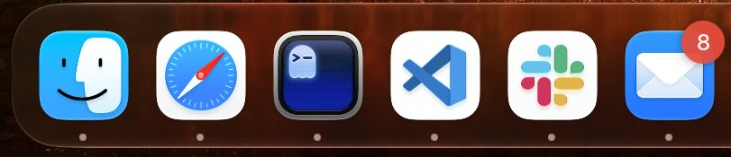

# dockhop: app launching for cool cats

This utility binds numeric hotkeys to launch or focus the apps in your macOS dock.
By default, CMD+N is used to launch/focus, so if your dock looks like the one below
pressing CMD+1 will run Safari, CMD+2 Ghostty, and so on.



That's basically all you need to know. Some extra details:
* The modifier(s) can be changed: shift, option, control, command
* Finder can be included as `modifier`+1 (disabled by default)
* Only pinned apps are included (called `persistent-apps` in the dock configuration). Spacers, separators, folders, etc. are ignored.

## Build and Run

```sh
make
./dockhop

# Or, alternatively:
DOCKHOP_CONFIG=config.example.json ./dockhop
```

## Configuration

If you'd like to change the defaults:
```sh
mkdir -p ~/.config/dockhop
cp config.example.json ~/.config/dockhop/config.json
```

Config precedence:
* `$HOME/.config/dockhop/config.json`
* Path in `DOCKHOP_CONFIG` environment variable
* Default settings (`modifiers`: command, `includeFinder`: false)

### Options

* `modifiers`: `command`, `option`, `control`, `shift` (note that `shift` must be combined with one of the other modifiers)
* `includeFinder`: `true` / `false`


```
                
     /\_/\    +- outta sight, daddy-o! -+
    ( o.o )
     > ^ <

```
